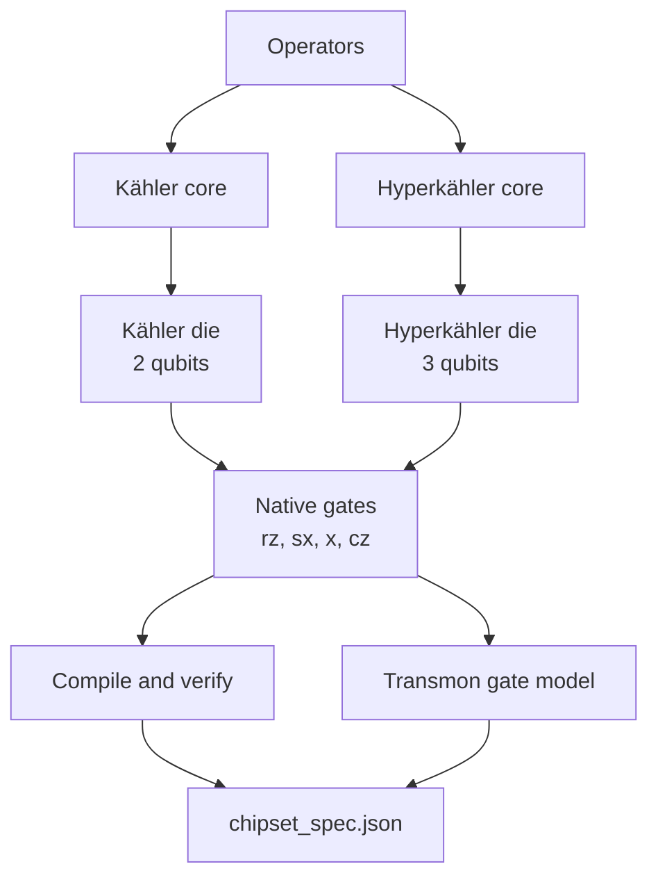

# Kähler / Hyperkähler Quantum Chipset

A pre-layout design model, in Qiskit, for a two-die superconducting chipset built from the
quantum-mechanics operator classes: unitary, Hermitian, projector, density matrix,
resolvent, Pauli and Hadamard.

| Die | Hardware | Geometry |
|---|---|---|
| **Kähler die** | 2 flux-tunable transmons, 1 coupler | Pure-state space CP³ with the Fubini–Study metric and Kähler form |
| **Hyperkähler die** | 3 flux-tunable transmons in a triangle, SU(2)-symmetric Heisenberg coupling | Quaternion triple I, J, K from -iσ; sphere of complex structures |

## Architecture

## Run it on GitHub Codespaces

A Codespace is a computer in the cloud that opens VS Code in your browser. You need a GitHub account and a repository that contains all the files from the Files table below at the top level (not inside a subfolder).

1. **Put the files in your repository.** On the repository page choose **Add file, Upload files**, drag in all the files, and choose **Commit changes**. Do not upload `README_19.md` or any old copies.
2. **Open a Codespace.** On the repository page click the green **Code** button, open the **Codespaces** tab, and choose **Create codespace on main**. Wait one to two minutes for the editor to load.
3. **Open a terminal.** In the editor use the menu **Terminal, New Terminal**. The terminal opens inside your repository folder.
4. **Install the requirements (once per Codespace):**

       pip install -r requirements.txt

5. **Run everything:**

       bash run_all.sh

   It runs seven Python files in order. The first six take a minute or two; the last one, `stage4_extract.py`, takes about 5 to 10 minutes. Run it this way rather than file by file, because `stage3_layout.py` needs the file `stage2_targets.json` that `stage2_quantization.py` writes.
6. **Check it worked.** A healthy run prints 101 lines containing `PASS` and none containing `FAIL`. It also prints a few lines containing `NOT MET` near the end. That is expected (see Stage 4 results below) and is not an error. To count them:

       bash run_all.sh | grep -c FAIL

   This should print `0`.
7. **Get the results.** The run creates these files in the repository folder: `chipset_spec.json`, `stage1_budget.json`, `stage2_targets.json`, `stage3_layout_report.json`, `stage4_extracted.json`, `stage4_K.json`, `stage4_H.json`, four `.gds` layout files (`kahler_die.gds`, `hyperkahler_die.gds` and the two `*_stage4.gds` versions) and eight `.png` previews. Click a `.png` in the Explorer panel on the left to view it. To download a file, right-click it and choose **Download**. To open a `.gds` file you need a layout viewer such as KLayout (free), on your own computer.
8. **Save your results (optional).** In the terminal run:

       git add -A
       git commit -m "Add run results"
       git push

9. **Stop the Codespace when finished.** It stops by itself after a period of inactivity. You can also stop or delete it at github.com/codespaces. Free accounts have a monthly allowance of Codespace hours.

### If something goes wrong

| Problem | Fix |
|---|---|
| `ModuleNotFoundError` | Run `pip install -r requirements.txt` again |
| `FileNotFoundError: stage2_targets.json` | Run `bash run_all.sh` instead of `python stage3_layout.py` on its own |
| `Permission denied` on `run_all.sh` | Run it with `bash run_all.sh` |
| Some line contains `FAIL` | Copy that line and the lines above it and send them to whoever maintains the project |

To run one file only: `python chipset.py`, `python stage1_budget.py`, `python stage2_quantization.py`, `python stage3_layout.py`, `python stage4_extract.py K` (or `H` for the other die), `python hyperkahler_unit.py` or `python kahler_hyperkahler_qiskit.py`.

## Run on your own computer

    pip install -r requirements.txt
    bash run_all.sh

## Files

| File | Contents |
|---|---|
| `kahler_hyperkahler_qiskit.py` | **Part 1** operator zoo with `Operator`, `SparsePauliOp`, `PauliEvolutionGate`, `NumPyEigensolver`. **Part 2** Kähler: quantum geometric tensor from `qiskit_algorithms` `ReverseQGT`; CP¹ metric, complex structure, Kähler form, 2-qubit CP³. **Part 3** hyperkähler: C² = ℍ realified on 2 qubits, with I, J, K as Pauli-product `Operator`s. |
| `hyperkahler_unit.py` | 3-qubit H = J·Σ(XX+YY+ZZ). Symmetry via `SparsePauliOp` algebra, spectrum, native-gate circuit vs exact `PauliEvolutionGate` (`process_fidelity`), geometry along the symmetry orbit with `ReverseQGT`. |
| `chipset.py` | A `PARAMS` block (baseline and sweep range for every design input) and derived transmon values (E_J, C_Σ, I_c); a Qiskit `Target` per die; `transpile` to native gates verified with `Operator.equiv`; 3- and 5-level transmon exchange gate (Qiskit Dynamics if installed, otherwise a matrix exponential, same results); 4-level flux-pulse CZ via the \|11⟩↔\|20⟩ crossing with Lindblad T1/T2; SU(2) disorder tolerance; junction-spread Monte Carlo for yield; Kähler-die geometry. Writes `chipset_spec.json`. |
| `stage1_budget.py` | **Stage 1.** SQUID flux response and 1/f flux noise at every operating point; DRAG single-qubit gate (pulse-level, 3 and 4 levels); dispersive readout and Purcell limit; per-gate error budget; hyperkähler circuit re-compiled with those errors. Writes `stage1_budget.json`. |
| `stage2_quantization.py` | **Stage 2.** Exact transmon (E_J, E_C) by charge-basis diagonalisation, flux bias and charge dispersion at every operating point, junction currents and sizes, target capacitance matrices, readout resonator lengths, tunable-coupler design, residual ZZ from the full coupled Hamiltonian. Writes `stage2_targets.json`. |
| `stage3_layout.py` | **Stage 3.** Parametric layout of both dies from the Stage 2 targets: Xmon-style islands, SQUID junctions (two junction layers), coupling capacitors, flux and drive lines, side-coupled λ/4 readout resonators, a shared Purcell-filter hairpin, launchers, airbridges, alignment marks. Runs 29 design-rule checks under assumed rules. Writes `kahler_die.gds`, `hyperkahler_die.gds`, PNG previews and `stage3_layout_report.json`. |
| `stage4_extract.py` | **Stage 4.** Built-in quasi-static capacitance solver (validated on a square plate), extraction of island, coupling and qubit-resonator capacitances in windows around each element, tuning of coupling-head widths and resonator couplings, resonator loading correction, design-rule re-check. Writes `stage4_extracted.json`, `stage4_K.json`, `stage4_H.json`, `kahler_die_stage4.gds` and `hyperkahler_die_stage4.gds`. |
| `run_all.sh` | Runs all seven in order (installs requirements first if missing). |
| `requirements.txt` | qiskit >=1.3,<3 (tested on 1.3.0 and 2.6.2), qiskit-algorithms 0.4.0, numpy, scipy, plus gdstk, shapely and matplotlib for Stage 3. |
| `requirements-dynamics.txt` | Optional, separate environment: Qiskit 1.3.0 + Qiskit Dynamics 0.6.0 for the transmon gate. |

## Build pipeline (linear, each stage has an exit gate)

| Stage | Content | Status |
|---|---|---|
| 0 | Freeze spec and decisions (`PARAMS`, `DECISIONS` in `chipset.py`) | Done: both dies and the coupler are flux-tunable |
| 1 | Flux noise, DRAG, readout and Purcell, error budget (`stage1_budget.py`) | Done, gates pass |
| 2 | Circuit quantization: capacitance matrices, junctions, coupler (`stage2_quantization.py`) | Done, gates pass |
| 3 | Parametric GDS and design-rule checks (`stage3_layout.py`, gdstk + shapely) | Done, 29/29 checks pass |
| 4 | Capacitance extraction and tuning (`stage4_extract.py`, built-in solver) | Done, but the capacitance budget is NOT MET: see below |
| 3b | Compact re-layout of both dies to fit the capacitance budget | Next |
| 5 | Re-run Qiskit loop with extracted values, yield Monte Carlo | Not started |
| 6 | Full-chip and package level (box modes, launchers, dicing) | Not started |
| 7 | Foundry swap (J_c, spread, stack, DRC deck) and tapeout package | Needs a foundry |

### Stage 1 results (generic baseline, not measured)

- **Flux noise sets T2 off the sweet spot.** At √A = 2 µΦ0/√Hz and SQUID asymmetry 0.3, echo dephasing is 12-36 µs at the parking points and about 19 µs at the hyperkähler operating point, well below the 80 µs baseline T2. Jitter-induced frequency noise at the operating point is about 49 kHz, far below the 1 MHz SU(2) tolerance. A 16-bit flux DAC is enough.
- **DRAG is not needed at 25 ns** for α = -220 MHz (plain Gaussian error about 1e-6). It matters at 10 ns and below, where it would buy faster gates.
- **Readout.** With resonators 1.6 GHz above the qubits, g = 100 MHz gives χ ≈ 0.76 MHz and about 0.4% readout error (500 ns, η = 0.5, so it assumes a parametric amplifier). The bare Purcell limit is about 36 µs, so a Purcell filter is required (about 650 µs with Q = 40). The SNR formula is approximate, up to a factor of about 2 depending on the detection scheme.
- **Gate budget.** 1Q about 1.5e-4; Kähler CZ (36 ns) about 2.0e-3; triangle XY exchange (17 ns) about 6.2e-3, of which 6.0e-3 is coherent leakage (a shaped pulse or lower g reduces it); a CZ on the fixed-g triangle is about 3.8e-3.
- **Hyperkähler unit circuit.** One Trotter step compiles to 9 CZ with estimated fidelity 0.96, five steps to 0.82. A native XY+CPhase gate set would give about 0.97 and 0.86 by a rough estimate, a modest gain.

### Stage 2 results (generic baseline, not measured)

- **Hyperkähler parking was changed.** The original parking (150 MHz spacing) gave 4-9 MHz of residual ZZ because |11⟩ sits close to |20⟩. Parking at 4.15 / 4.70 / 5.25 GHz gives under 1 MHz for every pair, and needs f_max = 5.5 GHz on that die. The cost is shorter T2 at the lowest parking point (about 12 µs).
- **Exact transmon values.** Reproducing α = -220 MHz exactly needs E_C ≈ 199 MHz (C_Σ ≈ 97 fF), not 220 MHz. E_J(sum) is about 17.0 GHz (Kähler) and 20.3 GHz (hyperkähler); E_J/E_C is 86 and 101.
- **Junctions.** SQUID critical currents are about 12 / 22 nA (Kähler) and 14 / 27 nA (hyperkähler), which is 155-230 nm square junctions at the assumed J_c = 0.5 µA/µm². J_c is foundry-dependent; the script prints sizes over 0.2-1.0.
- **Capacitors.** Triangle coupling capacitor about 0.58 fF per edge; Kähler direct 0.29 fF and qubit-coupler 3.5 fF; readout coupling capacitors 6-8 fF with λ/4 resonators 4.3-5.1 mm long.
- **Coupler.** 100 fF coupler with f_max 7.0 GHz. It is at zero coupling at 6.11 GHz (idle ZZ -0.016 MHz) and reaches the CZ coupling at 5.35 GHz.
- **Marginal point.** Charge dispersion at the lowest hyperkähler parking point is 1.8 kHz, just under the 2 kHz dephasing linewidth.

### Stage 3 results (generic rules, not a foundry's)

- **Two 10 × 10 mm dies, 1 nm GDS grid.** Layers: 1 metal, 2 and 3 junction electrodes, 4 airbridge landing pads, 5 airbridge spans, 6 outline, 10 text. Reading the files back confirms the size and layers.
- **Kähler die:** 3 islands (2 qubits and a coupler), 5 lines from the bottom edge, input and output launchers, 2 readout resonators (4575 and 4878 µm), Purcell filter 9443 µm. **Hyperkähler die:** triangle of 3 islands, 6 bottom lines (H2's flux and drive lines pass through the triangle on 2 signal airbridges over the H0-H1 wire), 3 resonators (5132, 4684, 4308 µm), filter 9369 µm. All resonator and filter lengths match their targets within 0.2%.
- **Ground plane.** Without airbridges each die splits into separate ground regions (before stitching: 2 regions on the Kähler die and 3 on the hyperkähler die, each including the main plane, so 1 and 2 cut-off islands). The script adds ground straps until the plane is one connected region, and keeps them 100 µm from islands and 120 µm from coupling capacitors. There are 35 and 39 airbridges in total, including periodic straps along the long lines.
- **Checks passed:** minimum metal width and gap, net-to-net spacing, no unintended grounding, ground connectivity, landing pads on ground, airbridge span, edge keep-out, CPW bend radius, junction sizes and overlap areas equal to Stage 2, launcher pitch.

**What Stage 3 does not give you:** the capacitances, couplings and resonator frequencies of this geometry are not yet known. Island sizes and coupling lengths use an assumed 0.08 fF per µm of facing edge. The junction layers are an idealised overlap, not a process-specific shadow-evaporation design. The design rules are generic. Resonator-to-filter coupling length (300 µm) and filter coupling gaps are starting guesses. Stage 4 extracts the real values and the layout is adjusted until they match the Stage 2 targets.

### Stage 4 results (built-in solver, about 5% accuracy)

- **Solver.** Quasi-static method of moments for zero-thickness conductors on an infinite silicon half-space. A 100 µm square plate comes out within 1.4% (fine mesh) and 1.2% (production mesh) of the reference value. It ignores metal thickness, substrate thickness and the package, so treat it as a design-loop tool, not sign-off. Palace or Elmer is still needed for that.
- **Main finding: the Stage 3 floorplan is over its capacitance budget.** A bare 8 µm coupling wire adds about 0.105 fF per µm, and the island cross alone (arms 210 µm) is already 105 fF. Each qubit carries 1.5 to 2.4 mm of arm and wire, so the total capacitance is 265 fF (Kähler qubits), 175 fF (coupler) and 195-211 fF (hyperkähler qubits), against targets of 97-100 fF. Tuning cannot fix this; the layout needs a compact re-layout in which each qubit has roughly 880 µm of conductor in total.
- **What did tune to target:** Kähler qubit-coupler capacitor 3.44 fF (target 3.46) and qubit-resonator capacitors within 3%; hyperkähler edges H0-H2 and H1-H2 0.574 fF (target 0.578) and qubit-resonator capacitors within 4%.
- **What did not:** the Kähler direct qubit-qubit capacitor cannot go below 0.58 fF (target 0.29) because the two long branch wires couple to each other; the hyperkähler H0-H1 edge is 17% low because one head width serves all three edges.
- **Resonator loading.** The qubit lowers each resonator by about 0.8-0.9% (for example 5.698 instead of 5.75 GHz), so the resonators were shortened by that amount in the `*_stage4.gds` files. The tuned layouts pass all 14 and 15 design-rule checks.

## Design parameters (generic baseline)

Defined in `PARAMS` in `chipset.py`, each with a sweep range. Typical of published Al/AlOx/Al-on-silicon transmons, not foundry data.

| Parameter | Baseline | Sweep |
|---|---|---|
| α (anharmonicity) | -220 MHz (exact E_C ≈ 199 MHz) | -260 to -180 |
| f01 max | 5.0 GHz Kähler, 5.5 GHz hyperkähler (E_J ≈ 17 / 20 GHz, C_Σ ≈ 97 fF) | 4.5-5.5 |
| Junction J_c (foundry-dependent) | 0.5 µA/µm² | 0.2-1.0 |
| Triangle exchange g (per edge) | 15 MHz | 10-20 |
| Kähler CZ effective g | 10 MHz (CZ ≈ 35 ns) | 6-14 |
| T1 / T2 | 100 / 80 µs | 30-200 / 20-150 |
| Junction resistance spread | 1.5% as-fabricated, 0.2% trimmed | 1-2%, 0.1-0.3% |

Main finding: with fixed-frequency qubits the as-fabricated spread gives σ_f ≈ 39 MHz, far larger than g, so the hyperkähler die needs trimming or per-qubit flux tuning to keep its SU(2) symmetry (see the yield table printed by `chipset.py`).

## Background

- Single-qubit pure states form CP¹ (the Bloch sphere), a Kähler manifold. Re(Q) is the
  Fubini–Study metric; Im(Q) gives the Kähler form (Berry curvature).
- The Pauli matrices give quaternion units (-iσ_x)(-iσ_y) = -iσ_z, the structure a
  hyperkähler manifold needs (three complex structures I, J, K with IJ = K).
- The hyperkähler die realises the SU(2) symmetry with native gates: XY exchange plus a ZZ phase.

## Status and caveats

- Simulation and design model plus a first-pass generic-rule layout (GDS). **Not EM-verified, not foundry DRC-clean**, and nothing has been fabricated;
  nothing runs on IBM hardware.
- **Tested on Qiskit 1.3.0 and 2.6.2** with identical results. Qiskit Dynamics needs qiskit <= 1.3, so it is optional: install `requirements-dynamics.txt` in a separate environment to use it.
- All frequencies, couplings, anharmonicities and gate errors are **illustrative
  placeholders**. Replace them with the chosen foundry process data.
- Flux-noise numbers use the standard 1/f model and are order-of-magnitude. Readout SNR is approximate.
- Gate numbers come from 3-5 level transmon models. The CZ uses a square flux pulse (no ramp, no distortion) with Lindblad T1/T2 only; crosstalk and TLS defects are not modelled, and the tunable coupler is represented only by an effective g.
- The Monte Carlo yield criteria (reachable parking frequencies, rms disorder below `su2_tol_MHz`) are design targets chosen here, not published thresholds.
- The capacitances in the Stage 4 results come from a built-in solver with about 5% accuracy and no package model. The resonator-to-filter coupling lengths are still starting guesses, and the filter coupling strengths have not been simulated.
- Next steps: a compact re-layout (Stage 3b) and a re-run of Stage 4, then Stage 5 re-simulation with extracted values, package level, and finally the foundry swap.
